<!-- =====================================================================
     HERO BANNER & STEALTH DARK/BLUE NAVIGATION BAR (NO PROFILE IMAGE)
     ===================================================================== -->

  <!-- Dynamic Animated Header Banner (Original Cyan/Blue Gradient) -->
  

   

  <!-- Row 1: Live Profile Views, Followers & Repositories Counter (Electric Blue Theme) -->
  

    &nbsp;&nbsp;
    &nbsp;&nbsp;
    
  

  <!-- Animated Typing Hook -->
  

    

  <!-- Row 2: Stealth Dark Social Bar with Cyan/Blue Icons -->
  

    &nbsp;&nbsp;
    &nbsp;&nbsp;
    &nbsp;&nbsp;
    &nbsp;&nbsp;
    
  

 

<!-- =====================================================================
     ABOUT ME (FULL-WIDTH BENTO COMPONENT)
     ===================================================================== -->
<table width="100%">
  <thead>
    <tr>
      <th align="left">⚡ ABOUT ME</th>
    </tr>
  </thead>
  <tbody>
    <tr>
      <td valign="top">
        

          I'm a <b>Full-Stack Software Engineer</b> focused on building scalable web applications, reliable backend systems, and practical software solutions.
        

        

          I enjoy working across the stack, understanding system internals, and making thoughtful engineering decisions. I've built and deployed an offline-first desktop application used in a live optical retail environment serving <b>100+ customers daily</b>.
        

        

          I approach engineering through problem-solving, experimentation, and continuous improvement.
        

      </td>
    </tr>
  </tbody>
</table>

 

<!-- =====================================================================
     GAMIFIED CONTRIBUTION HEATMAP (ABOVE TECH STACK)
     ===================================================================== -->
<table width="100%">
  <thead>
    <tr>
      <th align="left">🎮 LIVE CONTRIBUTION CHASE HEATMAP</th>
      <th align="right"></th>
    </tr>
  </thead>
  <tbody>
    <tr>
      <td colspan="2" align="center">
         
        <picture>
          <source media="(prefers-color-scheme: dark)" srcset="https://raw.githubusercontent.com/Shafee777/Shafee777/output/pacman-contribution-graph-dark.svg" />
          <source media="(prefers-color-scheme: light)" srcset="https://raw.githubusercontent.com/Shafee777/Shafee777/output/pacman-contribution-graph.svg" />
          
        </picture>
         
      </td>
    </tr>
  </tbody>
</table>

 

<!-- =====================================================================
     TECH STACK (2x2 ARCHITECTURAL BENTO GRID)
     ===================================================================== -->
<h2>🛠️ Tech Stack & Core Architecture</h2>

<table width="100%">
  <thead>
    <tr>
      <th width="50%" align="left">💻 LANGUAGES & CORE</th>
      <th width="50%" align="left">🎨 FRONTEND & UI</th>
    </tr>
  </thead>
  <tbody>
    <tr>
      <td valign="top" align="center">
         
        
          
        
        
        
        
        
          
      </td>
      <td valign="top" align="center">
         
        
          
        
        
        
        
          
      </td>
    </tr>
  </tbody>
  <thead>
    <tr>
      <th width="50%" align="left">⚙️ BACKEND & APIs</th>
      <th width="50%" align="left">🗄️ DATABASES & PLATFORMS</th>
    </tr>
  </thead>
  <tbody>
    <tr>
      <td valign="top" align="center">
         
        
          
        
        
        
        
          
      </td>
      <td valign="top" align="center">
         
        
          
        
        
        
        
        
          
      </td>
    </tr>
  </tbody>
  <thead>
    <tr>
      <th colspan="2" align="left">🧩 CORE COMPUTER SCIENCE FOUNDATIONS</th>
    </tr>
  </thead>
  <tbody>
    <tr>
      <td colspan="2" align="center">
         
        &nbsp;
        &nbsp;
        &nbsp;
        &nbsp;
        &nbsp;
        
          
      </td>
    </tr>
  </tbody>
</table>

 

<!-- =====================================================================
     CURRENT FOCUS (2x2 R&D MODULE CARDS)
     ===================================================================== -->
<h2>🔭 Current Focus</h2>

<table width="100%">
  <thead>
    <tr>
      <th width="50%" align="left">🧠 AI & LLMs</th>
      <th width="50%" align="left">🤖 RAG & AGENT SYSTEMS</th>
    </tr>
  </thead>
  <tbody>
    <tr>
      <td valign="top">
        
Exploring deep model architectures, context representation, and task-specific adaptation workflows.

        

          
          
          
          
        

      </td>
      <td valign="top">
        
Building context-aware retrieval pipelines and autonomous tool-using workflows over unstructured data.

        

          
          
          
          
        

      </td>
    </tr>
  </tbody>
  <thead>
    <tr>
      <th width="50%" align="left">🏗️ SYSTEM DESIGN</th>
      <th width="50%" align="left">📊 DATA SCIENCE</th>
    </tr>
  </thead>
  <tbody>
    <tr>
      <td valign="top">
        
Architecting high-availability backends, low-latency data access layers, and resilient storage schemas.

        

          
          
          
          
        

      </td>
      <td valign="top">
        
Applying statistical modeling, feature engineering, and vector similarity for predictive analytics.

        

          
          
          
          
          
        

      </td>
    </tr>
  </tbody>
</table>

 

<!-- =====================================================================
     FEATURED PROJECTS (PRODUCTION SHOWCASE CARDS)
     ===================================================================== -->
<h2>🚀 Featured Projects</h2>

<table width="100%">
  <thead>
    <tr>
      <th width="50%" align="left">
        📦 OPTICS CRM &nbsp;
      </th>
      <th width="50%" align="left">
        ⚡ CPAI — CP TRACKER &nbsp;
      </th>
    </tr>
  </thead>
  <tbody>
    <tr>
      <td valign="top">
        <h4>Offline-First Optical Retail CRM & POS</h4>
        

          Engineered a production-ready desktop system that streamlines optical retail operations, from prescriptions to billing and inventory.
        

        

          
          
          
        

         
        
      </td>
      <td valign="top">
        <h4>Competitive Programming Analytics Platform</h4>
        

          Unified coding performance, contest insights, and intelligent problem recommendations across competitive programming platforms.
        

        

          
          
          
          
          
        

         
        
      </td>
    </tr>
  </tbody>
</table>

 

<!-- =====================================================================
     GITHUB ANALYTICS DASHBOARD
     ===================================================================== -->
<h2>📊 GitHub Analytics</h2>

<table width="100%">
  <thead>
    <tr>
      <th colspan="2" align="left">📈 TELEMETRY & COMMIT METRICS</th>
    </tr>
  </thead>
  <tbody>
    <tr>
      <td colspan="2" align="center">
        
      </td>
    </tr>
    <tr>
      <td width="50%" align="center">
        
      </td>
      <td width="50%" align="center">
        
      </td>
    </tr>
    <tr>
      <td width="50%" align="center">
        
      </td>
      <td width="50%" align="center">
        
      </td>
    </tr>
  </tbody>
</table>

 

<!-- =====================================================================
     FOOTER
     ===================================================================== -->

  
  

